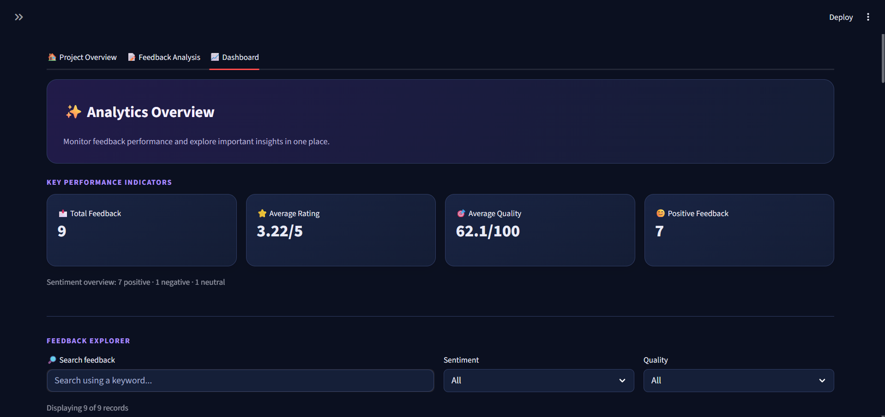
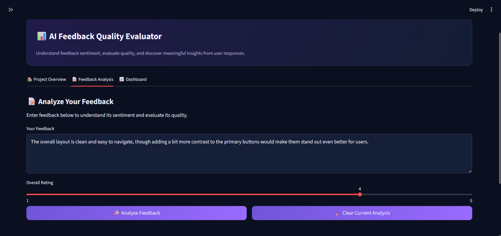
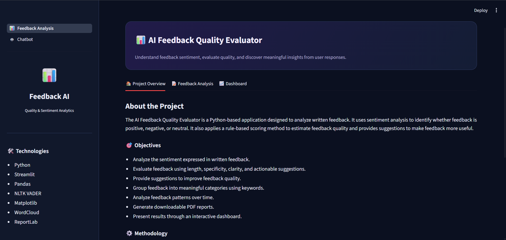
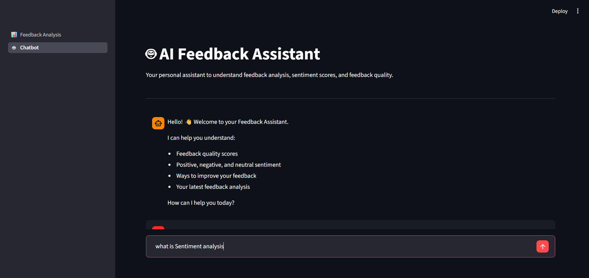

📊 AI Feedback Quality Evaluator

An interactive Python-based application that analyzes written feedback, identifies sentiment, evaluates feedback quality, and presents meaningful insights through a dashboard.

📌 Project Overview

The AI Feedback Quality Evaluator is designed to help understand and evaluate written feedback using Natural Language Processing (NLP) techniques and rule-based analysis.

The application uses NLTK VADER for sentiment analysis to identify whether feedback is positive, negative, or neutral. It also applies a rule-based scoring mechanism to evaluate feedback quality based on length, specific details, actionable suggestions, and clarity.

Additionally, the application provides feedback categorization, improvement suggestions, word cloud visualization, historical analysis, and an interactive dashboard.

🎯 Objectives

Analyze the sentiment expressed in written feedback.

Evaluate feedback quality using different parameters.

Identify positive, negative, and neutral feedback.

Categorize feedback using keyword-based classification.

Generate suggestions to improve feedback quality.

Visualize feedback patterns and trends.

Generate downloadable reports for analysis.

✨ Key Features

1. Sentiment Analysis

Uses NLTK VADER for sentiment analysis.

Identifies positive, negative, and neutral sentiment.

Calculates compound sentiment scores.

2. Feedback Quality Evaluation

Evaluates feedback using a rule-based scoring method.

Calculates a quality score out of 100.

Considers length and detail, specificity, actionable suggestions, and clarity.

Classifies feedback into High, Moderate, and Low quality levels.

3. Feedback Category Classification

Categorizes feedback using keyword-based classification.

Supports categories such as Trainer / Teaching, Course Content, Practical Sessions / Projects, Learning Materials, Infrastructure / Facilities, and General / Other.

4. Improvement Suggestions

Generates suggestions based on feedback quality scores and scoring parameters.

Helps users understand how to make their feedback more useful.

5. Interactive Dashboard

Displays total feedback, average rating, average quality score, and positive feedback.

Provides sentiment and quality visualizations.

Includes feedback search and filtering options.

Displays monthly feedback trends.

6. Word Cloud Visualization

Generates word clouds from feedback text.

Highlights frequently occurring words.

7. Feedback History Management

Stores feedback records in a CSV file.

Maintains previously submitted feedback.

Supports searching, filtering, and clearing feedback history.

8. Report Generation

Generates downloadable reports in supported formats, including PDF, CSV, and Excel.

Presents feedback summaries and analytical results.

9. Chatbot Interface

Provides a separate chatbot interface called AI Feedback Assistant.

Helps users understand sentiment analysis, feedback quality scores, and feedback improvement.

10. Light and Dark Theme

Provides theme selection for a comfortable viewing experience.

🖥️ Project Screenshots

1. Project Overview

2. Feedback Analysis

3. Dashboard

4. Chatbot

🏗️ System Architecture

The application follows a simple modular workflow:

              User Feedback
                    |
                    v
             Feedback Input
                    |
                    v
          Text Preprocessing
                    |
                    v
          Feedback Analysis
                    |
        +-----------+-----------+
        |           |           |
        v           v           v
    Sentiment    Quality     Category
    Analysis     Scoring   Classification
        |           |           |
        +-----------+-----------+
                    |
                    v
          Improvement Suggestions
                    |
                    v
          Dashboard & Visualizations
                    |
          +---------+---------+
          |                   |
          v                   v
     Feedback History    Report Generation
          |
          v
       CSV Storage

⚙️ Methodology

The project follows these steps:

Feedback Collection: Users enter written feedback and provide an overall rating.

Text Analysis: The feedback text is processed for sentiment analysis.

Sentiment Detection: NLTK VADER identifies positive, negative, or neutral sentiment.

Quality Evaluation: A rule-based scoring method evaluates feedback quality.

Category Classification: Feedback is grouped into categories using keywords.

Suggestion Generation: Improvement suggestions are generated based on the evaluation results.

Visualization: Results are displayed through charts, word clouds, and dashboard metrics.

Storage and Reporting: Feedback records are stored in CSV format, and downloadable reports can be generated.

🛠️ Technologies Used

Technology

Purpose

Python

Core programming language

Streamlit

Interactive web application

Pandas

Data handling and analysis

NLTK (VADER)

Sentiment analysis

Matplotlib

Data visualization

WordCloud

Word cloud generation

ReportLab

PDF report generation

CSV

Feedback data storage

VS Code

Development environment

Git & GitHub

Version control and project hosting

📂 Project Structure

AI-Feedback-Quality-Evaluator/
│
├── screenshots/
│   ├── project-overview.png
│   ├── feedback-analysis.png
│   ├── dashboard.png
│   └── chatbot.png
│
├── pages/
│   └── 🤖_Chatbot.py
│
├── utils/
│   ├── __init__.py
│   └── analysis_utils.py
│
├── 📊_Feedback_Analysis.py
├── chatbot.py
├── feedback_history.csv
├── requirements.txt
├── README.md
└── .gitignore

🚀 Installation and Setup

Follow these steps to run the project locally.

1. Clone the Repository

git clone https://github.com/PrakruthiGP/AI-Feedback-Quality-Evaluator.git

2. Navigate to the Project Folder

cd AI-Feedback-Quality-Evaluator

3. Install Required Dependencies

pip install -r requirements.txt

4. Run the Application

python -m streamlit run 📊_Feedback_Analysis.py

5. Open the Application

Streamlit will provide a local URL in the terminal. Open that URL in your web browser to access the application.

🔮 Future Enhancements

Integrate advanced NLP techniques for deeper feedback understanding.

Explore machine learning models for feedback classification.

Support additional feedback categories and domains.

Improve chatbot capabilities.

Add more advanced analytical visualizations.

Enable database integration for improved data management.

💡 Potential Applications

The project can be adapted for use in:

Educational institutions to understand student feedback.

Customer service teams to analyze customer opinions.

E-commerce platforms to understand product reviews.

Organizations to evaluate employee feedback.

Service-based businesses to identify areas for improvement.